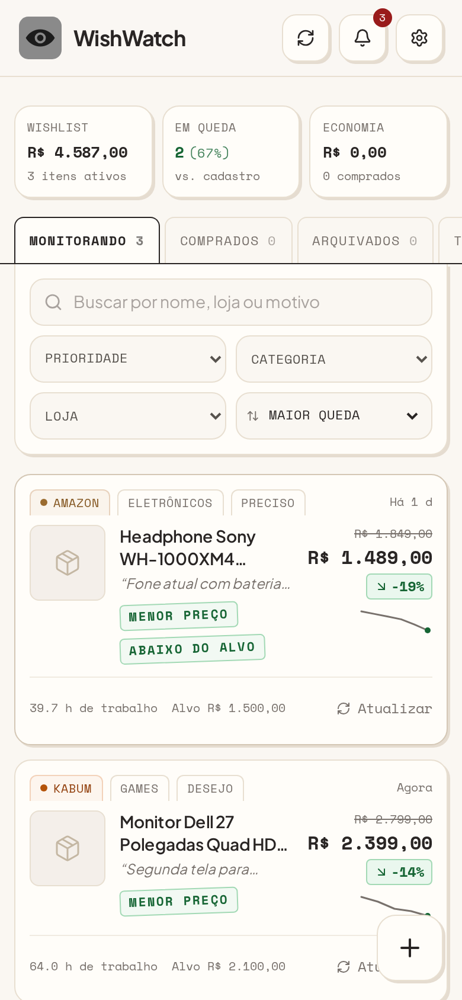
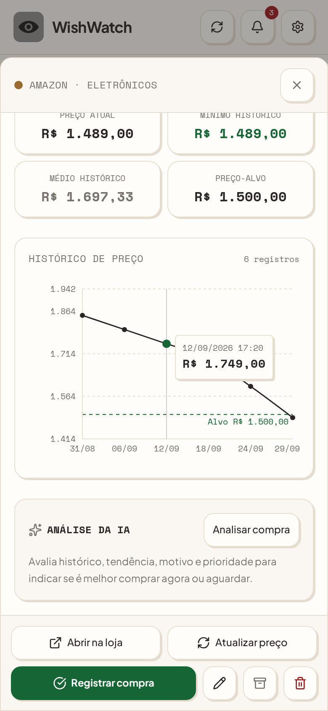
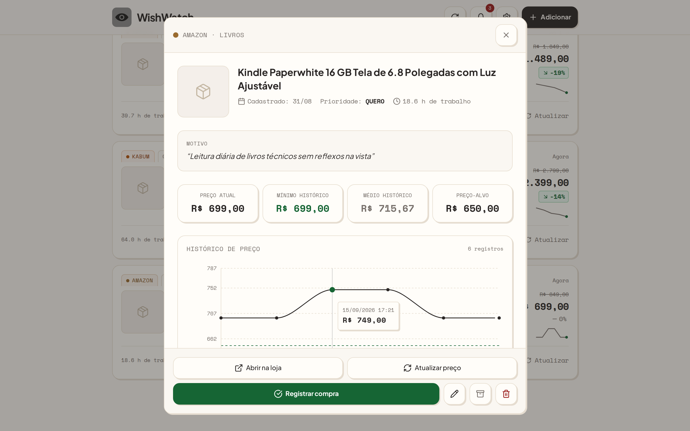

<div align="center">


# WishWatch

Wishlist com monitoramento de preços. Cole o link de um produto, registre por que você quer comprá-lo e acompanhe o histórico de preço com alertas de queda.


</div>

<p align="center">
  
  &nbsp;
  
</p>

## Funcionalidades

- **Cadastro por link**: o Gemini lê a página do produto e preenche nome, loja, imagem, preço e categoria. Funciona com Amazon, Mercado Livre, Magalu, Kabum, Shopee e outras lojas.
- **Motivo e prioridade**: cada item guarda por que você quer comprá-lo (Preciso / Quero / Desejo).
- **Histórico de preço**: gráfico com preço-alvo, mínimo, médio e variação desde o cadastro.
- **Alertas**: preço abaixo do alvo, queda percentual configurável, menor preço registrado e volta ao estoque. As notificações usam o service worker, então funcionam no Android com o app instalado.
- **Análise de desconto**: o carimbo `DESCONTO INFLADO` aparece quando a loja mostra um "de/por", mas o histórico já registrou aquele preço antes.
- **Custo em horas de trabalho**: com a renda mensal e as horas trabalhadas, cada produto mostra quanto tempo de trabalho representa.
- **Análise da IA**: recomendação objetiva ("Comprar agora" ou "Aguardar") com base em histórico, tendência, motivo e prioridade.
- **Economia registrada**: ao marcar um item como comprado, o app soma a diferença entre o preço do cadastro e o valor pago.
- **PWA instalável**: funciona offline para consulta, com ícone monocromático para temas do Android.
- **Backup**: exportação e importação da wishlist em JSON.

## Stack

| Camada | Tecnologia |
| --- | --- |
| Interface | React 19, TypeScript, Tailwind CSS 4, Recharts, Lucide |
| Servidor | Express (rotas `/api`) + Vite em modo middleware no desenvolvimento |
| IA | `@google/genai` com `gemini-2.5-flash`, usando as ferramentas `urlContext` e `googleSearch` |
| PWA | `vite-plugin-pwa` (Workbox), fontes locais via Fontsource |
| Dados | `localStorage`, atrás de uma interface de repositório |

## Arquitetura

```
src/
├── components/        # UI (cards, modais, cabeçalho) e primitivas em ui.tsx
├── hooks/             # instalação do PWA e status de conexão
├── services/
│   ├── priceChecker.ts      # extração de preço com Gemini (sem dependência do navegador)
│   ├── purchaseAnalyzer.ts  # análise de compra com Gemini
│   ├── monitor.ts           # regras de alerta e notificações
│   ├── storage.ts           # repositório (hoje em localStorage)
│   └── apiClient.ts         # chamadas do front para o servidor
├── types/
└── utils/
server.ts              # Express: /api/check-price, /api/analyze-purchase, /api/health
```

Decisões que valem destacar:

- **A chave do Gemini fica no servidor.** O front só conversa com `/api/*`, então a chave nunca vai para o navegador.
- **`priceChecker` e `purchaseAnalyzer` não dependem de React nem do navegador.** A mesma lógica pode rodar num job agendado (cron) para monitorar preços 24/7.
- **`storage.ts` expõe uma interface `IProductRepository`.** Trocar `localStorage` por Firebase ou Supabase é implementar essa interface.
- **Leituras com baixa confiança não disparam alertas.** Ficam marcadas como `REVISÃO MANUAL`, para evitar notificações falsas.

## Como rodar

Pré-requisitos: Node.js 22+ e uma [chave da API do Gemini](https://aistudio.google.com/apikey).

```bash
npm install
cp .env.example .env.local   # e preencha GEMINI_API_KEY
npm run dev                  # http://localhost:3000
```

Sem a chave, o app funciona com preenchimento manual. Para ver o app com dados, use **Configurações → Carregar exemplo**.

| Script | O que faz |
| --- | --- |
| `npm run dev` | servidor Express + Vite com hot reload |
| `npm run build` | build de produção em `dist/` |
| `npm start` | serve o build de produção |
| `npm run lint` | checagem de tipos com `tsc` |
| `npm run icons` | regenera os ícones do PWA a partir de `scripts/generate-icons.js` |

## Identidade visual

O app segue o estilo **Retro Ledger**: fundo linho (`#FAF7F2`), cards off-white com sombra sólida de 2px, textos em Plus Jakarta Sans e valores em Space Mono. O ícone segue o padrão monocromático do Android: squircle cinza com símbolo preto.

<p align="center">
  
</p>

## Próximos passos

- [ ] Monitoramento 24/7 com GitHub Actions (cron) usando o `priceChecker`
- [ ] Persistência em nuvem (Supabase ou Firebase) implementando `IProductRepository`
- [ ] Extensão de navegador para adicionar produtos direto da página da loja
- [ ] Testes unitários para as regras de alerta em `monitor.ts`

## Licença

[MIT](LICENSE)
